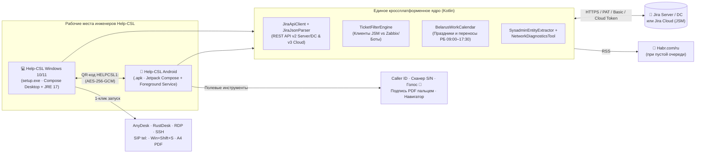

<div align="center">


# Help-CSL

**Кроссплатформенное рабочее место системного администратора, диспетчера и выездного инженера техподдержки Jira**  
*Фирменный корпоративный стиль `csl.by` (`#04091E` + `#F7631B`) · Полная синхронизация между **Windows 10/11 (`setup.exe`)** и **Android (`.apk`)***

[](https://github.com/zigorminsk-debug/Helpdesk/releases/latest/download/setup.exe)
[-2EB85C?style=for-the-badge&logo=android&logoColor=white)](https://github.com/zigorminsk-debug/Helpdesk/releases/latest)
[-04091E?style=for-the-badge&logo=readthedocs&logoColor=white)](GUIDE.md)
[](AGENTS.md)

</div>

---

## 📌 О программе

**Help-CSL** — специализированный клиент и инженерный комбайн для служб технической поддержки и системного администрирования, работающих с **Jira Server / Data Center** (REST API v2) и **Jira Cloud / Jira Service Management** (REST API v3).

В отличие от стандартного веб-интерфейса и универсальных клиентов Jira, **Help-CSL** спроектирован специально под реальные задачи дежурной смены, сервисной мастерской и выездных инженеров:
- **Не требует отдельного бэкенд-сервера и плагинов в Jira** — работает напрямую через штатный REST API вашего сервера Jira (включая внутренние корпоративные серверы с самоподписанными SSL-сертификатами).
- **Единая экосистема «ПК + Смартфон»** — настольная версия для **Windows 10/11 (`setup.exe`)** и мобильное приложение для **Android (`.apk`)** используют общее ядро бизнес-логики, мгновенно обмениваются настройками по зашифрованному QR-коду `HELPCSL1:` и в реальном времени синхронизируют заявки, журнал мастерской **«В ремонт»**, справочник **«Клиент / Организация»** и закрытый **«Чат»** инженеров.
- **Умное разделение живых клиентов и шума мониторинга** — клиентские обращения портала JSM (включая системный тип `Service Request`, *«Проблемы с ПК/Ноутбуком»* и др.) попадают в активные очереди со звуковым оповещением, а автоматические события `zabbix`, `prometheus`, `grafana`, `nagios` и ботов отводятся во вкладку **«Сервисные»** без ложных тревог.
- **Производственный календарь Республики Беларусь (`Europe/Minsk`)** — уведомления и звук работают строго в рабочее окно смены (`09:00`–`17:30`) с учётом официальных государственных праздников РБ, Радуницы и переносов рабочих суббот Совета Министров РБ.

---

## 📥 Установка и быстрый старт

Актуальные сборки автоматически формируются в GitHub Actions и публикуются в разделе [**Releases**](https://github.com/zigorminsk-debug/Helpdesk/releases/latest):

| Платформа | Установочный пакет | Особенности установки |
|---|---|---|
| 💻 **Windows 10 / 11 (x64)** | [**`setup.exe`**](https://github.com/zigorminsk-debug/Helpdesk/releases/latest/download/setup.exe) | Автономный инсталлятор Inno Setup 6 со встроенной средой исполнения (`jpackage`). **Не требует установленной Java** и **не требует прав администратора Windows**. Создаёт ярлык на Рабочем столе и (опционально) автозапуск в системный трей. |
| 📱 **Android 8.0+ (API 26+)** | [**`help-csl-v1.0.XX.apk`**](https://github.com/zigorminsk-debug/Helpdesk/releases/latest) | Подписан постоянным ключом `keystore/helpdesk-release.p12` — устанавливается **поверх предыдущей версии** без удаления приложения и без потери настроек. |

### ⚡ Настройка второго устройства за 3 секунды (`📲 Перенос QR`)
1. Настройте подключение к Jira на любом одном устройстве (на ПК или на смартфоне) во вкладке **«Настройки»** и нажмите **«Проверить подключение»**.
2. Откройте **«📲 QR»** — на экране появится зашифрованный QR-код формата `HELPCSL1:` (`AES-256-GCM` + `GZIP`, с поддержкой опционального PIN-кода).
3. На втором устройстве отсканируйте QR-код камерой (или вставьте текстовый код `HELPCSL1:...`) — URL сервера, тип авторизации, правила фильтрации, шаблоны ответов и график РБ применятся мгновенно.

---

## 🏗 Архитектура решения



---

## 🧩 Полное описание модулей и возможностей

### 1. Очередь заявок («Заявки») и продуманная эргономика карточек
- **4 основные вкладки очереди**:
  - **«Новые»** — свежие клиентские обращения (включая *«Ожидание поддержки»*) и автоматически возвращённые по расписанию отложенные тикеты;
  - **«В работе»** — заявки, принятые инженерами в исполнение (с быстрым отбором **«Все» / «Мои» / «Свободные»**);
  - **«Закрытые»** — решённые, выполненные и отклонённые обращения клиентов (**«Все» / «Мои»**);
  - **«Сервисные»** — отфильтрованные технические задачи мониторинга (`zabbix`, `prometheus`, автоправила) с пояснением причины отсева и полным отключением звуковых тревог.
- **Компактные карточки без «пустого воздуха»**:
  - На самом верху крупным жирным шрифтом выделено **Имя клиента / Организация** (*например, `Сейлзмодерн`, `ЖКХ`*);
  - Ниже компактным моноширинным шрифтом расположен **номер заявки** (`CSL-37368`), статус, исполнитель и живой **SLA-таймер ожидания** (`⏱ зелёный < 15 мин` / `жёлтый 15–45 мин` / `красный > 45 мин`);
  - Все вкладки и кнопки спроектированы без обрезки текста (`...`) и без лишнего пустого пространства внутри карточки.
- **Быстрые действия прямо из списка (Android)**:
  - **Свайп вправо** → мгновенно взять заявку **«В работу»**;
  - **Свайп влево** → **«Позвонить»** клиенту (или обсудить в чате, если номер не указан);
  - **Режим массового выбора (`☑`)** → взять в работу, прокомментировать или закрыть сразу пачку тикетов в 1 касание;
  - **Создание новой заявки (`➕`)** вручную или голосом `🎤` прямо с телефона или ПК.
- **Экран чистой очереди**: когда все новые заявки разобраны, отображаются плавные анимации из *«Компьютерщиков» (The IT Crowd — Рой и Мосс)* только с цитатой, а сразу под гифкой загружается свежая лента статей **Habr.com** (*Сисадмин, Новости, Лучшие*).

---

### 2. Полный цикл обработки заявки (Workflow) и отсрочка с пересозданием
- **«▶ В работу»** — автоматически назначает текущего инженера исполнителем в Jira и переводит заявку в рабочий статус (при неоднозначной схеме бизнес-процесса предлагает удобный выбор доступного перехода Jira).
- **«⏰ Отложить на...»** — уникальный механизм для обращений *«перезвоните в понедельник в 10:00»*:
  1. Исходная заявка **немедленно закрывается** с корректным комментарием об отсрочке, не портя SLA текущей смены;
  2. Ставится точный таймер (системный будильник Android / фоновый планировщик Windows);
  3. В назначенные дату и время программа **автоматически создаёт новую заявку** со всеми исходными полями, контактами и историей клиента, подаёт звуковой сигнал и помещает её во вкладку **«Новые»**.
- **«✖ Отклонить»** — запрашивает причину отклонения (текстом, макросом или голосом `🎤`) и закрывает тикет.
- **«✅ Завершить»** — публикует финальный комментарий о решении, переводит тикет в закрытые и **автоматически возвращает инженера в главный список очереди**.
- **«👤 Коллеге»** — поиск по списку доступных сотрудников проекта в Jira и мгновенная переадресация тикета.
- **Безопасное комментирование JSM**: переключатель **«🌍 Ответ клиенту»** ↔ **«🔒 Внутренняя заметка JSM»** (`sd.public.comment = internal: true`, видна только инженерам), редактируемые **1-тап шаблоны быстрых ответов** и списание трудозатрат в **`⏱ Worklog`**.
- **История обращений клиента**: прямо внутри карточки показываются предыдущие заявки этой же организации для быстрого понимания контекста.

---

### 3. Суперспособности настольной версии для Windows 10/11 (`setup.exe`)
Настольное приложение создано для максимальной скорости работы дежурного администратора за монитором:
- **Двухпанельный интерфейс (Split-View)**: слева — живая очередь и поиск, справа — полный инспектор выбранной заявки.
- **1-клик запуск средств удалённого доступа и администрирования**:
  - Автоматическое распознавание 9–10-значных ID **AnyDesk** и **RustDesk** в описании и комментариях тикета → кнопка в 1 клик запускает установленный `AnyDesk.exe` или `rustdesk.exe` с мгновенным подключением к ПК клиента (и копирует ID в буфер обмена);
  - По распознанным IPv4-адресам и доменам → кнопки запуска **RDP (`mstsc.exe /v:host`)** и терминала **SSH (`ssh host`)**.
- **IP-телефония (SIP) и десктопные мессенджеры**:
  - Автоматическая нормализация белорусских (`+375`) и российских (`+7`) номеров из любого формата (`8 029 ...`, `8 (916) ...`);
  - Кнопка **«📞 SIP звонок»** передаёт номер по протоколу `tel:` в корпоративный софтфон Windows (*MicroSIP, 3CX, PhonerLite, Zoiper*), а кнопки **Telegram**, **Viber** и **WhatsApp** открывают чат с клиентом одним кликом.
- **Мгновенная вставка скриншотов `Win + Shift + S` без сохранения файлов**:
  - Нажмите стандартное сочетание Windows `Win + Shift + S` (или `PrtSc`), выделите область экрана и нажмите в заявке кнопку **«📸 Вставить скриншот (Win+Shift+S)»** — изображение напрямую читается из системного буфера обмена Windows и прикрепляется PNG-файлом в Jira!
- **Системный трей Windows и всплывающие баннеры**:
  - При закрытии окна (`✕`) программа не выгружается, а сворачивается в системный трей Windows (со счётчиком новых тикетов во всплывающей подсказке);
  - При поступлении новой клиентской заявки в рабочее время РБ справа внизу над часами всплывает компактный баннер поверх всех окон с кнопками **«▶ В работу»** и **«Открыть»**.
- **Генерация и печать документов A4 PDF**: формирование кириллических *Актов выполненных работ*, *Квитанций о приёме в ремонт* и *Актов выдачи* на базе Apache PDFBox с автоматическим прикреплением PDF в Jira.

---

### 4. Полевой и телефонный арсенал инженера на Android (`.apk`)
- **Системный определитель номера клиента (`Caller ID`)**: работает через штатный `CallScreeningService` (без запроса доступа к истории звонков!). При входящем звонке с номера из базы тикетов показывает плашку с организацией клиента, ключом открытой заявки и заметкой из локального досье.
- **Окно «📞 Итог звонка» (`Post-Call Worklog`)**: сразу после телефонного разговора с клиентом предлагает в 1 тап списать `5 / 10 / 15 / 30 мин` в `Worklog` Jira и надиктовать голосом `🎤` результат звонка.
- **Камерный сканер штрихкодов и QR серийных номеров (`S/N`, `INV`, `MAC`)**: распознаёт заводские линейные и двумерные коды (`CODE_128`, `CODE_39`, `EAN_13`, `QR`, `DataMatrix`) и мгновенно поднимает всю историю ремонтов данного устройства по базе Jira.
- **PDF-акт с росписью клиента пальцем на экране (`✍️ PDF-акт`)**: чек-лист работ + живая подпись заказчика на экране смартфона → готовый брендированный файл `Akt_CSL-XXXXX.pdf` автоматически улетает во вложения заявки Jira.
- **Кнопка «🗺 Маршрут в Навигатор»**: автораспознавание улиц и домов в тексте заявки с построением маршрута в Яндекс.Навигаторе, Яндекс.Картах или Google Maps.
- **Офлайн-очередь действий**: при работе в подвальной серверной или в дороге без связи все переходы, комментарии, `Worklog` и сообщения чата сохраняются локально и автоматически отправляются в Jira при появлении сети.
- **Виджет `4×2` на рабочий стол** и **плитка быстрых настроек в шторке Android (`Help-CSL Дежурство`)**.

---

### 5. Встроенный сетевой комбайн и диагностика хостов
Прямо из карточки заявки (и на Android, и на Windows) выполняется экспресс-диагностика найденных IP-адресов и доменов клиента:
- **ICMP Эхо (`Ping`)** с измерением задержки в миллисекундах;
- **Сканирование ключевых сервисных TCP-портов**: `80 (HTTP)`, `443 (HTTPS)`, `3389 (RDP)`, `22 (SSH)`, `8291 (MikroTik WinBox)`, `445 (SMB)`;
- **HTTP/HTTPS-зонд**: код ответа и заголовок веб-сервера;
- **Контроль срока действия SSL-сертификата**: `Subject CN`, издатель, точная дата истечения и остаток дней с предупреждением об истекающем сертификате;
- **Системное разрешение адресов** и ручная проверка DNS A/AAAA/MX/TXT/NS/AD SRV на явно указанных серверах;
- **Офлайн-распознавание вендора по MAC-адресу (OUI)**: мгновенно определяет `MikroTik`, `Cisco`, `Ubiquiti`, `TP-Link`, `Keenetic/ZyXEL`, `Huawei`, `HP`, `Dell`, `Lenovo`, `Hikvision`, `Synology`, `Kyocera`, `APC` и др.

---

### 6. Мастерская «В ремонт» (`REM-1001+`), справочник клиентов Helpdesk и аудит «Удалённые»
Полноценный журнал учёта клиентского оборудования, принятого на диагностику и ремонт, синхронизируемый между всеми инженерами через служебный реестр Jira (`[HELPCSL_REPAIR_REGISTRY_ROOM]`):
- **Быстрый приём техники**: создание карточки с нуля, сканированием штрихкода `S/N` (камерой телефона или ручным USB-сканером на ПК) либо в 1 клик прямо из заявки Jira (**«🔧 Принять в ремонт»** с автозаполнением клиента, телефона, номера `CSL-…` и описания неисправности).
- **Автоподгрузка справочника «Клиент / Организация» из Helpdesk**:
  - Программа автоматически выгружает список организаций и клиентов из Jira Helpdesk (`JSM Organizations`, кастомные поля компании и авторы реальных клиентских заявок без `zabbix`/ботов);
  - При вводе названия организации открывается живой поиск с автоподстановкой телефонного номера;
  - Каждый новый клиент, внесённый вручную при приёме техники, автоматически пополняет общий справочник.
- **Прозрачные этапы ремонта**: `Принято` → `На диагностике` → `Ждёт ЗЧ` → `В ремонте` → `Готово к выдаче` → `Выдано клиенту`, учёт комплектности (*БП, кабель, сумка, картридж и т. д.*), внешнего вида и полки на складе.
- **Защита от бесследного удаления («🗑 Удалённые»)**:
  - При удалении карточки она **никогда не исчезает бесследно**, а перемещается во вкладку **«🗑 Удалённые»**;
  - В карточке сохраняется полный аудит: **кто удалил** (ФИО / логин инженера), точные дата и время, причина удаления (синхронизируется у всей команды), а также кнопка **«↩ Восстановить»**.
- **Печать квитанций А4 PDF**: формирование *Квитанции о приёме* и *Акта выдачи* в 1 клик.

---

### 7. Закрытый «Чат» инженеров и аналитика «📊 Статистика смены»
- **Вкладка «Чат»**: внутренний командный мессенджер техподдержки поверх закрытой служебной комнаты Jira (`HELPCSL_ADMIN_CHAT_ROOM`, полностью невидимой для клиентов):
  - **📌 Закреп дежурной смены** вверху экрана для передачи важных сведений между сменами;
  - Быстрые статусы (`👀 Смотрю`, `📞 Звоню клиенту`, `🚗 На выезде`, `✅ Сделал`), цитирование ответов, отправка по `Ctrl + Enter` на ПК и голосовой ввод `🎤` на Android;
  - Интерактивные упоминания заявок (`CSL-37368`) с переходом к карточке тикета в 1 клик.
- **Окно «📊 Статистика смены»**: сводка поступивших и закрытых заявок за сегодня и за 7 дней (по всей службе и лично по инженеру), процент выполнения SLA `< 15 мин`, среднее время реакции, таблица выработки инженеров и топ активных организаций.

---

### 8. Уведомления, график работы РБ, двойной звук и безопасность
- **Производственный календарь РБ (`09:00`–`17:30`)**: автоматический расчёт праздничных дней РБ (включая переходящую Радуницу), официальных переносов рабочих суббот и пользовательских дат отпуска/дежурств.
- **Двойной вывод звука на Android (включая Xiaomi MIUI / HyperOS)**: одновременное воспроизведение сигнала вызова и в подключённую Bluetooth-гарнитуру, и на внешний динамик смартфона, чтобы не пропустить заявку, когда наушники лежат на столе.
- **Голосовое чтение новых заявок (`TTS`)** и **защита от «Шторма заявок»** (группировка массовой пачки алертов в одно сводное уведомление).
- **Криптографическая защита данных**:
  - На Android — `EncryptedSharedPreferences` (`Android Keystore AES-256-GCM`) + опциональный вход по отпечатку пальца (`Biometric Lock`);
  - На Windows — локальное шифрование состояния и токенов `AES-256-GCM` в `%APPDATA%\Help-CSL\state.enc`;
  - Локальное **«📋 Досье клиента»** для хранения служебных памяток по каждой организации.
- **Бесшовное автообновление**: встроенная проверка свежих релизов через Atom-ленту GitHub Releases (без ошибок `GitHub API 403 rate limit`) со скачиванием и запуском обновления в 1 клик как на Android (`.apk`), так и на Windows (`setup.exe`).

---

## 📂 Структура репозитория

```text
Helpdesk/
├── app/                                # Мобильное приложение Help-CSL для Android (Jetpack Compose)
│   └── src/main/java/com/helpdesk/jiraagent/
│       ├── data/                       # Единый клиент Jira REST API v2/v3, парсер JSM и RSS Habr.com
│       ├── domain/                     # Фильтр JSM/Zabbix, календарь РБ, нормализатор телефонов, сеть, SLA
│       ├── model/                      # Общие модели заявок, «В ремонт», справочника клиентов и «Чата»
│       ├── service/                    # Фоновая служба мониторинга Android, АОН (Caller ID), будильники
│       ├── notification/               # Пуш-баннеры, двухканальный звук (динамик + BT) и TTS
│       ├── update/                     # Менеджер автообновления APK с проверкой SHA-256
│       └── ui/                         # Экраны, карточки, камерный сканер S/N, PDF с подписью и виджет 4×2
├── windows-desktop/                    # Настольное приложение Help-CSL для Windows 10/11 (Compose Desktop)
│   ├── build.gradle.kts                # Сборка автономного образа jpackage со встроенной JRE 17
│   ├── installer/help-csl.iss          # Скрипт Inno Setup 6 для упаковки инсталлятора setup.exe
│   └── src/main/kotlin/com/helpdesk/desktop/
│       ├── Main.kt                     # Главное окно, системный трей Windows и всплывающие тост-баннеры
│       ├── DesktopController.kt        # Контроллер очередей, синхронизации «В ремонт», «Чата» и обновлений
│       ├── DesktopTicketViews.kt       # Сплит-панель заявок, инспектор сисадмина, GIF + лента Habr.com
│       ├── DesktopRepairAndChatViews.kt# Мастерская «В ремонт», справочник клиентов, «Удалённые» и «Чат»
│       ├── DesktopSettingsAndDialogsViews.kt # Фильтр, настройки, статистика смены, QR и справочник
│       ├── DesktopSystemIntegrations.kt# AnyDesk/RustDesk/RDP/SSH/SIP, буфер Win+Shift+S, печать A4 PDF
│       └── DesktopStorage.kt           # Шифрование AES-256-GCM (%APPDATA%\Help-CSL) и кодек HELPCSL1
├── keystore/                           # Постоянный ключ подписи релизных Android-сборок
├── .github/workflows/build-apk.yml     # Параллельный CI/CD конвейер (Ubuntu Android + Windows setup.exe)
├── GUIDE.md                            # Полное пошаговое руководство пользователя и инженера
└── README.md                           # Обзор и описание проекта на GitHub
```

---

## 🛠 Локальная сборка и CI/CD

Каждый `push` в репозиторий автоматически запускает конвейер GitHub Actions (`.github/workflows/build-apk.yml`):
1. **`ubuntu-latest`** — прогоняет модульные тесты, собирает и подписывает релизный `help-csl-v1.0.XX.apk` постоянным ключом `keystore/helpdesk-release.p12` и проверяет подпись через `apksigner`;
2. **`windows-latest`** — компилирует настольное приложение с общим ядром Kotlin, формирует автономный образ со встроенной JRE (`createDistributable`) и упаковывает установщик **`setup.exe`** через Inno Setup 6;
3. **`publish-release`** — объединяет оба артефакта и контрольные суммы в единый выпуск **GitHub Releases**.

### Сборка вручную из исходного кода
**Android APK** *(требуется JDK 17 и Android SDK 35)*:
```bash
./gradlew testReleaseUnitTest assembleRelease -PversionCode=1033 -PversionName=1.0.33
```

**Windows `setup.exe`** *(требуется Windows 10/11 x64, JDK 17 и Inno Setup 6)*:
```powershell
.\gradlew.bat -p windows-desktop createDistributable -PversionCode=1033 -PversionName=1.0.33
"C:\Program Files (x86)\Inno Setup 6\ISCC.exe" /DAppVersion=1.0.33 windows-desktop\installer\help-csl.iss
```

---

## 📖 Полная документация

Подробнейшая инструкция по каждому экрану, настройке разрешений на смартфонах **Xiaomi MIUI / HyperOS**, работе с мастерской «В ремонт», отложенными заявками и настольным клиентом Windows находится в файле [**GUIDE.md — Полный гайд по программе Help-CSL**](GUIDE.md), а также встроена непосредственно внутрь обеих версий программы по кнопке **«📖 Гайд»**.

### Справочный анализ обращений
В карточке заявки раскройте «Анализ обращений»: темы по ключевым словам заголовков, источники, выбор автора или явно указанной организации JSM. История ограничена доступными проектами, правами, фильтрами и поиском до 500 заявок; при отсутствии ID возможна неточность по имени. Подробности и причины проверяются в исходных заявках.

### Окна и оформление
Инструменты и формы Windows открываются внутри главного окна; вкладки переносятся по ширине. Добавлены светлые палитры «Серо-голубая» и «Тёплая бумага» и тёмная «Watchdog» с синими акцентами; размер текста Windows настраивается.

При обнаруженной потере связи с Jira Help-CSL показывает пульсирующее предупреждение и один раз за инцидент подаёт сигнал и голосовую фразу. Это предупреждение о связи с данного устройства; проверяйте сеть, VPN и сервер. Обнаружение зависит от опроса и расписания, а воспроизведение — от системного звука и TTS.
